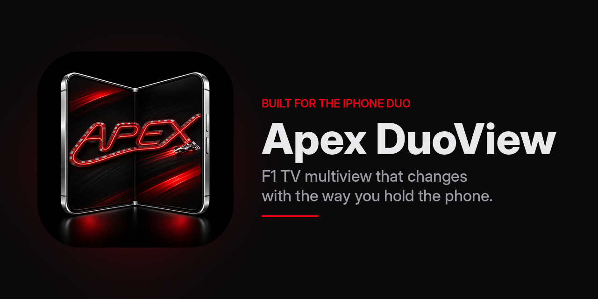

# Apex DuoView

An iPhone app for watching F1 TV that is built around the iPhone Duo's fold. The official F1 TV
app looks the same on every phone. This one changes with the way you hold the phone: closed,
open flat, half-open like a book, propped like a laptop, or standing on its edges. Several feeds
at once, a live track map, timing and team radio, all kept in sync with the picture.

> **Unofficial.** This app isn't made, endorsed or supported by Formula 1, Formula One
> Management or F1 TV. You need your own F1 TV subscription (Premium for several feeds at once).
> Video plays through F1 TV with your own account; nothing is downloaded or unlocked. F1 TV's
> terms don't cover third-party apps, so use it at your own risk.

## Status

**v1.0-beta.2 — Multiview and fold** is released (2026-11-14, pre-release; see the
[changelog](CHANGELOG.md)). On top of beta.1 (sign in with your F1 TV account, browse Race
Weekend, Paddock and the archive, one feed with your choice of commentary, resume where you
stopped), it plays four feeds at once in step, fitted to every fold of the phone, with your
favourite driver's onboard, sound from any feed, drag to rearrange, presets, picture in picture
and resume. Some of it is not yet tested by hand: the changelog lists what is still to check.
Tested in the iPhone Duo simulator; the real Duo comes in beta.7.
Next: **v1.0-beta.3**.

What has been checked so far, on a 2026 race replay with a Premium account: F1 TV returns all 26
feeds of a race (world feed, F1 Live, every onboard, data channels) in a format the iPhone's own
video player supports. Live sessions are still to be tested.

## What it will do

Each pose has its own way of watching:

- **Laptop (half-open on a table):** the picture on the upright half and a race engineer's console
  on the half lying flat. Or scrub through a replay on a touch timeline of flags, overtakes, pit
  stops and radio.
- **Book (half-open, fold upright):** two onboards side by side, kept level on track so both cars
  reach each corner together, with the gap between them on the fold.
- **Closed:** a glanceable companion with one driver's team radio and transcript, a gap meter,
  and an alert that jumps you to the moment when you open the phone.
- **Open flat:** a director's desk with the main picture, a tray of feeds, the timing tower and
  the map. Or lay it between two people, with each half facing its viewer.
- **Standing on its edges:** a large-type timing board you can read across the room, which turns
  yellow or red on a flag.

Folding and unfolding moves you between them without losing your place. Closing the phone
bookmarks the moment.

It also carries over everything from the Android app it started from:

- Multiview of up to four feeds.
- A track map with flags, timing cards on onboards, and a pit circle.
- Team radio, picking up where you left off, and picture in picture.
- The full catalogue back to 1981, and the season calendar with reminders.

The full list and the order it's built in are in [docs/roadmap.md](docs/roadmap.md).

## Roadmap

Seven betas, one release candidate, then v1.0. Each beta ends with a test the owner checks on a
real phone. Version numbers and releases follow the standard written in the roadmap. Changes are
listed in [CHANGELOG.md](CHANGELOG.md).

## Requirements

- An iPhone running iOS 27.1 or later (confirmed: the SDK declares the fold APIs from 27.1). The
  fold features need an iPhone Duo; on other iPhones the app works like the Duo's closed screen.
- An F1 TV plan that includes video (Pro or Premium); several feeds at once needs Premium.
- To build it yourself: a Mac with Xcode 27.1 or later.

## Build it yourself

1. Install XcodeGen: `brew install xcodegen`
2. Clone the repository and check out the `ios` branch.
3. Copy `Config/Signing.local.xcconfig.example` to `Config/Signing.local.xcconfig` and set your
   own bundle ID and team in it. This file is never committed.
4. Run `xcodegen generate`.
5. Open the generated project in Xcode and run it.

## Branches

- **`ios`:** this app, Apex DuoView. All iOS work happens here.
- **`og-android`:** a copy of the original Android app, kept in step with its author's repository.
  It's the reference for porting and isn't changed here. The two branches are never merged.

## Privacy

In beta.1 the app talks only to F1's servers, with your own sign-in. Later betas will also fetch
MultiViewer's public circuit data. There are no analytics, no accounts of its own and no servers in between. Your F1 TV
sign-in stays on your phone.

## Credits

- Started from [Apexview](https://github.com/mikeyyy0/apexview), the Android app for foldables,
  MIT licensed.
- The F1 TV API and login flow come from [eXhumer/f1tv-api](https://github.com/eXhumer/f1tv-api)
  and [eXhumer/eXViewer](https://github.com/eXhumer/eXViewer), both MIT licensed.
- How F1's timing archive and live feed are laid out follows [FastF1](https://github.com/theOehrly/Fast-F1).
- Turn numbers and circuit outlines come from [MultiViewer](https://multiviewer.app)'s public
  circuit data.
- Thanks to Brother ADLL for helping pick the app icon.

## License

MIT; see [LICENSE](LICENSE).
